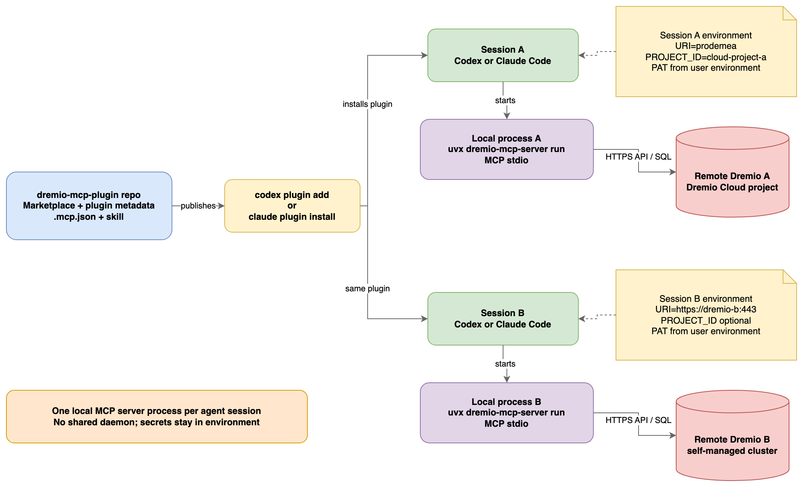

# Architecture

This repository is a small plugin marketplace. It does not contain the Dremio MCP server implementation. Instead, it publishes plugin metadata, a `.mcp.json` server definition, and a companion skill.

Editable diagram: [dremio-mcp-architecture.drawio](dremio-mcp-architecture.drawio)

## Runtime Model

Each Codex or Claude Code session starts its own local `dremio-mcp` server process through `uvx`.

The process is session-scoped:

- Session A starts one local MCP server process.
- Session B starts a separate local MCP server process.
- Processes communicate with the agent over MCP stdio.
- Processes read Dremio connection settings from the environment.
- Each session can inherit different Dremio connection settings, so Session A and Session B can point to different Dremio Cloud projects or self-managed clusters.
- The upstream server can also read `.env` and the default `~/.config/dremioai/config.yaml` fallback described in [config.md](config.md).
- No shared daemon is expected or required.

## Components

| Component | Responsibility |
|---|---|
| Marketplace metadata | Makes the plugin installable through `codex plugin add` and `claude plugin install`. |
| `.mcp.json` | Declares the `dremio-mcp` local MCP server command. |
| `uvx` | Fetches and runs the official `dremio/dremio-mcp` server in an isolated Python tool environment. |
| Environment variables | Provide URI, PAT, project ID, and runtime defaults without storing secrets in this repository. |
| Dremio MCP server | Exposes Dremio catalog, metadata, and SQL tools to the agent. |
| Dremio Cloud or cluster | Serves the actual Dremio API and query workload. |

## Startup Flow

1. User starts a Codex or Claude Code session.
2. The installed plugin contributes the `dremio-mcp` MCP server definition.
3. The client starts `uvx --from git+https://github.com/dremio/dremio-mcp.git dremio-mcp-server run`.
4. `uvx` creates or reuses an isolated tool environment.
5. The MCP server reads `DREMIOAI_DREMIO__*` environment variables.
6. The agent calls Dremio MCP tools over local stdio.
7. The MCP server talks to Dremio Cloud or the configured self-managed cluster.

## Process Isolation

The local server is not shared across sessions. This keeps lifecycle, target Dremio instance, and credentials tied to the agent process that started it. Closing the session ends that session's local MCP process.

## Security Boundary

Secrets are not part of the plugin package. PATs and project-specific values belong in the user's environment or secret manager. The repository should not contain generated Dremio config files, local client configs with credentials, or customer-specific endpoints.

Configuration precedence is intentionally documented separately in [config.md](config.md) because existing user-level Dremio MCP config can affect a session when explicit environment variables are missing.
