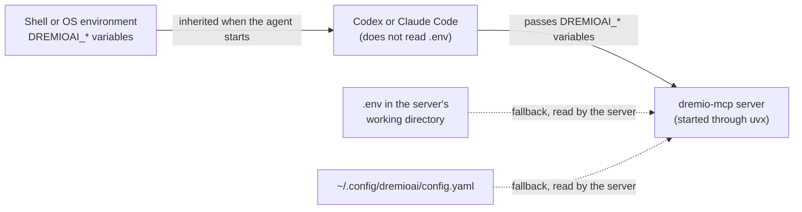

# Configuration

This page is the single reference for how Dremio connection settings reach the `dremio-mcp` server. The plugin stores no Dremio endpoints, PATs, project IDs, or generated config files.

## Short Version

Set `DREMIOAI_*` variables in the environment that starts Codex or Claude Code, then start a new agent session. Nothing else is required.

```bash
export DREMIOAI_DREMIO__URI=prodemea
export DREMIOAI_DREMIO__PAT=@~/.dremio/token
export DREMIOAI_DREMIO__PROJECT_ID="<project-id>"
```

Codex and Claude Code do not read `.env` files. A `.env` file only takes effect if you load it into your shell before starting the agent (see [Using a `.env` File](#using-a-env-file)).

## How Settings Reach The Server



1. **Your shell or OS environment.** You set `DREMIOAI_*` variables in the shell profile, the current terminal, or Windows user environment variables.
2. **The agent process.** Codex or Claude Code inherits that environment when it starts. Neither client reads `.env` files. A running session does not see later changes; start a new session.
3. **The MCP server process.** The agent starts `dremio-mcp` and passes the variables on. Claude Code passes its whole environment. Codex passes only a small set of system variables plus the names listed in `env_vars` in `plugins/dremio-mcp/.mcp.json`.
4. **Fallbacks inside the server.** The upstream server reads a `.env` file from its own working directory and the default `config.yaml` for any setting that is not already in its environment.

The plugin sets no `DREMIOAI_*` values itself; it only sets `PYTHONWARNINGS=ignore`. Your values therefore always apply.

## Variables

| Variable | Required | Upstream default | Recommended value | Meaning |
|---|---|---|---|---|
| `DREMIOAI_DREMIO__URI` | Yes | none | `prod`, `prodemea`, or `https://dremio.example.com:443` | Dremio Cloud region shortcut (`prod` = US, `prodemea` = EU) or full self-managed URL with `https://` and port |
| `DREMIOAI_DREMIO__PAT` | Yes | none | `@<path-to-token-file>` | Personal access token, or `@` followed by a path to a file that contains it |
| `DREMIOAI_DREMIO__PROJECT_ID` | Dremio Cloud only | none | your project ID | Dremio Cloud project |
| `DREMIOAI_TOOLS__SERVER_MODE` | No | `FOR_SELF` | `FOR_SELF,FOR_DATA_PATTERNS` | MCP tool sets the server exposes |
| `DREMIOAI_DREMIO__ENABLE_SEARCH` | No | `false` | `true` | Enables catalog search tools |
| `DREMIOAI_DREMIO__ALLOW_DML` | No | `false` | `false` unless writes are needed | `true` lets MCP tools create or change Dremio objects, such as views, within the user's permissions |

Without the optional variables the server runs read-only with the basic tool set. Codex forwards only the six variables in this table; other `DREMIOAI_*` settings work in Claude Code, `.env`, or `config.yaml`, but not from the Codex environment.

## Precedence

When the same setting is defined in several places, the upstream server uses the first match:

| Order | Source | Notes |
|---|---|---|
| 1 | Process environment | What the agent passed on. Recommended. |
| 2 | `.env` in the server's working directory | Optional fallback; depends on where the client starts the server. |
| 3 | `$XDG_CONFIG_HOME/dremioai/config.yaml` | Default `~/.config/dremioai/config.yaml`, also on Windows (`C:\Users\<user>\.config\dremioai\config.yaml`). |

Example: `DREMIOAI_DREMIO__URI=prod` in your shell and `uri: prodemea` in `config.yaml` connect to `prod`. If the shell variable is missing, the server silently uses `prodemea` from the YAML file.

The upstream server may create an empty `config.yaml` at the default path on first start.

## Recipes

### Shell Profile (Recommended)

macOS or Linux, in `~/.zshrc` or `~/.bashrc`:

```bash
export DREMIOAI_DREMIO__URI=prodemea
export DREMIOAI_DREMIO__PAT=@~/.dremio/token
export DREMIOAI_DREMIO__PROJECT_ID="<project-id>"
export DREMIOAI_TOOLS__SERVER_MODE=FOR_SELF,FOR_DATA_PATTERNS
export DREMIOAI_DREMIO__ENABLE_SEARCH=true
```

Open a new terminal, then start Codex or Claude Code from it.

Windows, as user environment variables:

```powershell
[Environment]::SetEnvironmentVariable("DREMIOAI_DREMIO__URI", "prodemea", "User")
[Environment]::SetEnvironmentVariable("DREMIOAI_DREMIO__PAT", "@C:\Users\<user>\.dremio\token", "User")
[Environment]::SetEnvironmentVariable("DREMIOAI_DREMIO__PROJECT_ID", "<project-id>", "User")
[Environment]::SetEnvironmentVariable("DREMIOAI_TOOLS__SERVER_MODE", "FOR_SELF,FOR_DATA_PATTERNS", "User")
[Environment]::SetEnvironmentVariable("DREMIOAI_DREMIO__ENABLE_SEARCH", "true", "User")
```

Open a new terminal, then start the agent. Windows processes do not see user-level changes until they restart.

Desktop apps started from the Dock, Start menu, or Finder may not load your shell profile. Start them from a configured terminal, or set the variables at OS level.

### Using a `.env` File

To keep per-project settings in a `.env` file, load it into the shell before starting the agent. This makes the values real environment variables, so they work the same way in Codex and Claude Code.

Start from one of the templates and fill in the placeholders:

| Template | Target |
|---|---|
| [`examples/dremio-cloud.env`](../examples/dremio-cloud.env) | Dremio Cloud project (`prod` or `prodemea`, project ID) |
| [`examples/dremio-software.env`](../examples/dremio-software.env) | Self-managed Dremio Software (coordinator URL) |

```bash
cp examples/dremio-cloud.env .env
```

Keep one setting per line with no quotes and no comments after a value, so the file loads the same way in bash and PowerShell.

macOS or Linux:

```bash
set -a
source .env
set +a
codex   # or: claude
```

Windows PowerShell:

```powershell
Get-Content .env | Where-Object { $_ -match '^\s*[^#].*=' } | ForEach-Object {
  $name, $value = $_ -split '=', 2
  Set-Item "Env:$($name.Trim())" $value.Trim()
}
codex   # or: claude
```

Do not commit `.env` files. This repository ignores them in `.gitignore`.

### Several Dremio Targets

Each agent session starts its own server process with the environment of that session. Use separate terminals or separate `.env` files to point sessions at different Dremio Cloud projects or clusters; see [architecture.md](architecture.md).

### Read-Only Or Write Access

Read-only is the default. To let MCP tools create or change Dremio objects, set `DREMIOAI_DREMIO__ALLOW_DML=true` before starting the agent. Writes are still limited by the Dremio permissions of the PAT owner.

## Checks

Show which values are present without printing the PAT.

macOS or Linux:

```bash
env | grep '^DREMIOAI_' | sed -E 's/(DREMIOAI_DREMIO__PAT=).*/\1<redacted>/'
test -f .env && sed -E 's/(DREMIOAI_DREMIO__PAT=).*/\1<redacted>/' .env
test -f ~/.config/dremioai/config.yaml && sed -E 's/(pat:).*/\1 "<redacted>"/' ~/.config/dremioai/config.yaml
```

Windows PowerShell:

```powershell
Get-ChildItem Env:DREMIOAI_* | ForEach-Object {
  if ($_.Name -eq "DREMIOAI_DREMIO__PAT") { "$($_.Name)=<redacted>" } else { "$($_.Name)=$($_.Value)" }
}
Test-Path .env
$cfg = Join-Path $HOME ".config\dremioai\config.yaml"
if (Test-Path $cfg) { Get-Content $cfg | ForEach-Object { $_ -replace '(^\s*pat:\s*).*', '$1"<redacted>"' } }
```

## Troubleshooting

| Symptom | Check |
|---|---|
| Server reports missing URI or PAT | The variables were not set in the terminal that started the agent, or the session started before you set them. Start a new session. |
| Values from `.env` are ignored | The agent does not read `.env`. Load it with `set -a; source .env; set +a` before starting the agent. |
| Server connects to an unexpected Dremio target | A `.env` in the working directory or `~/.config/dremioai/config.yaml` fills a missing variable. Set the variable explicitly or remove the stale file. |
| Dremio Cloud project not found | Set `DREMIOAI_DREMIO__PROJECT_ID`. |
| Search or data-pattern tools missing | Set `DREMIOAI_DREMIO__ENABLE_SEARCH=true` and `DREMIOAI_TOOLS__SERVER_MODE=FOR_SELF,FOR_DATA_PATTERNS`. |
| Write tools refuse to run | `DREMIOAI_DREMIO__ALLOW_DML` is `false` (default). |

Never paste PAT values into issues, logs, or pull requests.

## Upstream References

- [Dremio MCP settings documentation](https://github.com/dremio/dremio-mcp/blob/main/docs/settings.md)
- [Dremio MCP settings source](https://github.com/dremio/dremio-mcp/blob/main/src/dremioai/config/settings.py)
